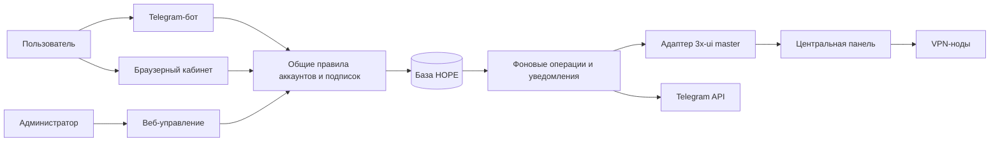

# Архитектура сервиса

Дата: 12 октября 2026. Реализовано и развёрнуто локально; концептуальные сущности ниже могут объединяться в моделях. Текущее устройство и проверки: [operations.md](operations.md), [отчёт](research/2026-10-12.md). Условия продукта: [product.md](product.md). Перенос и проверки: [launch.md](launch.md).

## 1. Простой состав

Общий home_screen формирует главный экран для /start и callback menu по текущей
TelegramIdentity. Формирование экрана не создаёт заказов и не меняет привязку.

Telegram callback-экраны используют общий render_screen: editMessageText
обновляет исходное сообщение и inline-клавиатуру. Команды используют sendMessage;
outbox сохраняет независимую доставку. Неизменный экран игнорируется, новый
отправляется только при явной невозможности редактирования. Сетевые ошибки и
429 не вызывают запасную отправку. Состояние навигации не хранится в БД.

Предлагаемый стек: Python, Django, PostgreSQL, aiogram для бота, серверные HTML-шаблоны с небольшим JavaScript. Django даёт готовую основу пользователей, сессий, форм, миграций и администрирования. Это выбор для малого сервиса с ручной работой владельца; отдельный SPA и микросервисы не нужны.

Единый репозиторий, три процесса из одного приложения: веб, Telegram-бот, фоновый worker. База собственная, отдельная от схемы 3x-ui; доступ к PostgreSQL панели не использовать для изменений. Очередь фоновых операций на PostgreSQL с арендой заданий и блокировками; Redis/Celery пока необязательны.



Автоматизация технического применения ручной команды владельца нужна: он подтверждает срок один раз, сервис обновляет панель и сообщает результат. Автоматически распознавать переводы или решать коммерческое продление сервис не будет.

## 2. Границы ответственности

| Данные | Ответственный источник |
|---|---|
| Аккаунт, логин/пароль, Telegram, восстановление, история действий | База HOPE |
| Коммерческое решение о сроке после принятия клиента под управление | Журнал ручных операций HOPE |
| VPN-секреты, фактические привязки, технические лимиты/счётчики и применённый срок | 3x-ui master |
| Фактическая работоспособность каждого транспорта | Отдельные технические проверки |

Хранить отдельно желаемое и наблюдаемое состояние; несогласованность не скрывать. При первичном импорте действующие значения панели имеют приоритет. После перехода под управление ручное изменение срока в панели становится конфликтом: остановить запись этого клиента, показать различия и предложить владельцу «Принять панель» или «Применить решение сервиса». Не откатывать вручную сделанное продление тихо в фоне.

Интеграция может менять только определённые поля конкретного клиента. Транспорты, Hosts, порядок профилей, routing и службы остаются ответственностью инфраструктурного проекта. Привязка Telegram только в HOPE по умолчанию; поле `tgId` панели не трогать ради уведомлений.

## 3. Сущности

| Сущность | Основное содержание |
|---|---|
| Account | Внутренний ID, номер клиента, уникальный нормализованный логин, хэш пароля, состояние входа |
| TelegramIdentity | Account ID, уникальный Telegram user ID, private chat ID, время подтверждения, доступность канала |
| Subscription | Account ID, желаемый срок, версия, тип срока, коммерческое состояние |
| PanelBinding | Устойчивая идентичность панели/клиента, наблюдаемые срок/enable/квота/inbound IDs, время чтения, статус управления |
| Plan | Название и явно выбранная календарная/дневная длительность; необязательная согласованная цена, версия |
| AdminOperation | Кто, причина, тип действия, старое/целевое состояние, ID идемпотентности, результат |
| OperationStep | Этапы чтения/записи/проверки клиента и нод, попытки, ошибки, восстановление после сбоя |
| Invitation / LinkChallenge | Назначение, адресат, хэш токена, срок, состояние, подтверждения сторон |
| RecoveryCode / Session | Хэши одноразовых кодов; отдельные управляемые сессии |
| RenewalRequest | Заявка клиента, комментарий, состояние обработки; без автоматического статуса оплаты |
| Outbox / Notification | Задание, канал, событие, версия срока, результат, следующая попытка |
| SupportRequest / AuditEvent | Обращения и журнал действий с минимальными персональными данными |

Username/email в 3x-ui могут быть служебной меткой, а не email владельца. Не использовать их как веб-логин или канал восстановления. UUID, subId и остальные секреты хранить только там, где это необходимо адаптеру, шифровать; в журнал — маскированный идентификатор.

Один старый человек может иметь несколько технических записей; одинаковый subId может объединять профили. Нужен анализ фактической структуры, а не правило «один inbound = один человек». Конфликтные группы не импортировать как автоматически подтверждённые аккаунты.

## 4. Независимые состояния

Не делать одно поле `active`, смешивающее всё:

- Аккаунт: invited / enabled / locked / archived.
- Telegram: unlinked / linked / unreachable.
- Подписка: pending / active / expired / perpetual; административная приостановка отдельно.
- Технический доступ: enabled / disabled / quota_exhausted / unknown.
- Синхронизация: unmanaged / queued / applying / verified / partial / conflict / failed.

Например, коммерческий срок активен, но квота исчерпана: интерфейс сообщает именно это. Аккаунт может входить в кабинет после истечения, чтобы получить помощь и продлить. Блокировка кабинета не подразумевает остановку VPN; остановка VPN — явное отдельное действие.

## 5. Ручное продление как надёжная операция

1. Владелец открывает актуальную карточку; сервис читает панель и проверяет отсутствие конфликта.
2. Выбирает длительность/точную дату и основание; видит предварительный результат.
3. Подтверждает. В транзакции блокируется подписка, проверяется версия и создаются операция, целевой абсолютный срок и outbox-задание.
4. Worker последовательно применяет изменения этого клиента, сохраняя его остальные поля.
5. После записи читает клиента повторно и проверяет срок, enable, привязки и доступное состояние нод. HTTP 200 или `success=true` недостаточно для полной проверки.
6. При успехе отмечает операцию verified и отправляет результат. При частичном результате показывает «Срок сохранён, применение требует проверки», с уведомлением владельцу.

Записывать абсолютную дату, вычисленную один раз. При ретрае нельзя снова прибавлять месяц. Два одновременных разных продления: второе получает конфликт версии и требует нового предпросмотра. Повторный клик/запрос с тем же operation ID возвращает прежний результат.

Транзакции общей базы и панели нет. Перед записью сохранять закрытый снимок клиента; после таймаута сначала читать фактическое состояние. Если цель уже применена, завершить проверку; если состояние изменилось иначе — конфликт. Ошибка сообщения в Telegram не откатывает срок.

Для истёкшего клиента включение разрешено только если причиной отключения было истечение и нет административного запрета или исчерпанной квоты. Импортированный `enable=false` с неизвестной причиной требует решения владельца. При задержке применения возобновляемого доступа после истечения срок можно сдвинуть по явной компенсирующей операции, а не скрытому ретраю; её правило согласовать с владельцем. Первичная выдача отсчитывает срок от фактического успешного применения.

Календарные вычисления описаны в product.md. При первом создании проверить интерпретацию «0», отрицательных дат, единиц срока и traffic-полей в установленной панели: не догадаться по названию поля.

## 6. Адаптер 3x-ui

Интерфейс адаптера: чтение клиентов/состояния, создание отдельного клиента, применение целевых полей, чтение актуальной подписки, проверка привязок. Конкретные пути/форматы фиксируются после проверки установленной версии 3.9.0 и её API; текущая ветка upstream не равна установленному контракту.

В текущей [официальной документации clients API](https://github.com/MHSanaei/3x-ui/blob/main/docs/content/docs/en/reference/api/clients.mdx) клиент представлен общей сущностью с прикреплениями к инбаундам; update описан как замена записи. Поэтому безопасный подход — прочитать текущую запись, изменить нужные поля, сохранить неизвестные поля, проверить повторным чтением. Подтвердить это поведение на установленной версии до записи в продакшен.

Если API не поддерживает условную запись по версии, блокировка в HOPE не защищает от параллельного изменения через UI панели. Сократить окно read/write, проверять изменения до/после и ввести правило: обслуживаемые клиенты меняются через HOPE; аварийное изменение в панели сопровождается разбором конфликта. Полной атомарности между двумя интерфейсами без поддержки панели нет.

Обращаться к master, не менять SQLite нод и generated Xray JSON. Не использовать shell/SSH для каждой операции бота. Сетевой доступ административного API — через закрытый защищённый канал с проверкой TLS; API не публиковать без ограничений для пользователей кабинета.

Создание: отдельные секреты для нового человека; только согласованные рабочие инбаунды. Набор 10 профилей — конфигурация продуктового пакета по документам исследования, а не жёсткое копирование ID в код. Исключения старых клиентов сохранить. Не включать inbound14/AUTO всем. Проверять фактическую выдачу каждого протокола: одного VLESS UUID недостаточно для предположений о Hysteria2 auth.

В research зафиксирован перезапуск Xray на Сербии при ошибке hot-apply. Изменения последовательные, с ограничением частоты и circuit breaker при признаках проблем. Не обещать отсутствие перерывов. Сбой ноды не должен вызывать бесконечное повторение полной записи клиента или глобальный restart.

## 7. Выдача персональных ссылок

Первая версия сохраняет действующие subscription URL 3x-ui; не превращает кабинет в обязательный прокси для каждого обновления VPN-конфигурации. Поэтому отказ нового приложения не ломает уже настроенный клиент. Веб-страница подписки 3x-ui не заменяет независимый кабинет.

Личный кабинет выдаёт ссылку только аутентифицированному владельцу. Старый subId — секрет доступа к настройкам, не пароль кабинета и не доказательство владения. Публичная страница статуса не возвращает конфиги.

QR и страницы с конфигами: `Cache-Control: no-store`, запрет сторонних ресурсов/аналитики, `Referrer-Policy: same-origin` (без передачи адреса внешним сайтам), скрытие секретных URL в логах. Не кэшировать персональные данные service worker. Не делать открытый endpoint «введите UUID — покажем срок и Telegram».

Утечка subscription URL и утечка уже импортированных VPN-ключей — разные случаи. Смена subId сама по себе может не отозвать скопированный профиль. Отзыв подключения требует смены соответствующих протокольных секретов на всех прикреплениях; пользователь повторно импортирует профиль. Это отдельная операция с предупреждением, не часть обычного продления.

## 8. Безопасность аккаунтов и поддержки

Хэширование паролей — Argon2id через поддерживаемую реализацию, параметры подобрать по ресурсам сервера. Пароли/восстановительные коды/токены не писать в логи. Административные действия требуют авторизации и CSRF-защиты; пользовательские записи выбираются по текущему Account ID, а не произвольному ID из формы.

Лимиты входа, восстановления, регистрации и привязки — по аккаунту и источнику, с нарастающей задержкой. Не делать постоянную блокировку аккаунта только из-за чужих неверных попыток. Ответ о неверном логине/пароле одинаковый; recovery не раскрывает существование аккаунта. Предлагаемый стартовый предел кодов — 5 попыток на challenge, затем перевыпуск, с ограничениями по времени.

Cookies Secure/HttpOnly/SameSite, сессии на сервере, ротация при входе, logout всех устройств, ограниченный redirect только на известные адреса. Смена логина/пароля/Telegram требует повторного подтверждения. Отвязать Telegram можно с паролем и кодом восстановления либо после ручной проверки; нельзя требовать единственно Telegram, который уже потерян.

Пригласительные токены — случайные не менее 128 бит, отдельные назначения и сроки; GET не расходует токен. Предлагаемый срок приглашения 72 часа, входа из бота 1 минута, привязки 10 минут. Первое открытие приглашения само по себе не активирует владение: перед выдачей существующего доступа владелец проверяет получателя через прежний контакт. При подозрении на утечку приглашение отзывается.

Защита от случайной отправки VPN-ссылки вместо приглашения: разные форматы, подписи кнопок и предупреждение в админке. Бот не принимает произвольные URL подписок для скачивания: исключаются утечка чужого доступа и SSRF. Диагностика/поддержка автоматически скрывает токены; пользователь предупреждён не присылать полный QR.

Предлагаемая минимизация хранения: журналы входа 30 дней, обращения 90 дней после закрытия; история продлений/операций и резервные копии по отдельно утверждённым срокам. IP и user agent — только для безопасности, без истории посещаемых VPN-сайтов. Пароли, токены, персональные QR и реальные выгрузки не попадают в Git.

## 9. Размещение и сопровождение

Рекомендуется отдельный небольшой сервер приложения, чтобы сбой VPN-входа или перегрузка ноды не закрывали помощь и вход. Минимальный размер определить после замера приложения и Argon2; не считать свободную память master гарантированным бюджетом. Можно временно разместить рядом с master только после оценки ресурсов, ценой общего отказа.

База доступна только приложению. Web/worker/bot используют разные минимальные права по возможности. Бот первой версии может работать long polling; публичный Telegram webhook тогда не нужен. После рестарта pending-задания продолжаются из базы, задания с истёкшей арендой подхватываются заново. Никаких in-memory таймеров как единственного расписания.

Резервные домены дают отдельные origin: на них входить заново, не переносить cookies и токены через URL. Разрешённые hosts/CSRF origin задаются явно. Резерв приложения восстанавливается из согласованного бэкапа, а не работает параллельно как второй независимый master записи.

Ежедневный шифрованный бэкап своей базы и ключевого конфигурационного материала на отдельное хранилище; код и зависимости зафиксированы; восстановление проверять на изолированной среде. Предлагаемые начальные цели: RPO до 24 часов, RTO до 4 часов. При восстановлении older-базы автоматически запрещать записи панели до сверки более новых изменений, чтобы не сократить оплаченные сроки.

Метрики: возраст последнего чтения панели, очередь/возраст операций, failed/partial/conflict, доставка уведомлений, ошибки входа и API, свободное место/ресурсы. Алерты администратору о проблемах; публичный статус отделён от внутренних адресов/секретов. Для продления должна быть возможность аварийного ручного изменения панели с последующим импортом решения в HOPE.

## 10. Предлагаемая структура репозитория

```text
hopevpnbot/
  app/
    accounts/       # логины, сессии, восстановление, Telegram-привязка
    subscriptions/  # сроки, ручные операции, заявки
    panel/          # единственный адаптер 3x-ui
    bot/            # обработчики и клавиатуры
    portal/         # кабинет, подключение, помощь
    operations/     # административные экраны и аудит
    jobs/           # очередь, применение, уведомления, сверка
    support/        # обращения без зависимости от Telegram
  templates/
  static/
  tests/
  deploy/
  docs/
```

Это первоначальные логические границы. Реализация компактнее: `core/models.py` — данные, `core/services.py` — общие правила аккаунтов и подписок, `core/panel.py` — интеграция, `core/jobs.py` — очередь, `core/bot.py` и `core/views.py` — интерфейсы, `config/` — настройка. Бот и веб вызывают общие правила; отдельной логики продления в них нет.

## Экстренный час

Общее правило `prepare_operation(kind="emergency")` разрешает пользователю действие только со своей подпиской. Лимит проверяется под блокировкой Subscription; принятые Operation являются журналом попыток и идемпотентности, отдельная модель не нужна. Целевой срок фиксируется при принятии запроса, а не сдвигается каждым повтором. Worker использует прежний протокол записи/сверки, отказывает без записи, если час истёк до первой попытки применения. Дневной предел считается в МСК, трёхчасовой интервал непрерывен между датами. Сбой/partial не удаляет попытку из лимита. См. [0002](sdd/changes/0002-emergency-hour.md).

## Публичный путь на общем домене

Принято владельцем: домен панели, путь `/hope/`. Префикс выводится из SITE_URL и задаёт FORCE_SCRIPT_NAME, STATIC_URL и пути cookies. Reverse/redirect используют именованные маршруты; ссылки из бота включают SITE_URL. Прокси снимает префикс перед передачей приложению, сохраняет Host и явно перезаписывает HTTPS-заголовок. Имена cookies HOPE отделены от панели; общий origin сохраняется. Панельные API/выдача не переносятся под `/hope/`. Конфигурация и границы — [0003](sdd/changes/0003-shared-domain.md), [operations](operations.md).

## Заказы и клиенты приложений

BotContact хранит адрес личного Telegram-ответа и состояние текстового обращения, PurchaseOrder — снимок цены/срока, статус ручной проверки и связь с Operation. Ручной paid отдельно от provisioning/fulfilled; verified worker-операции завершает заказ. Уникальный активный заказ по контакту/аккаунту и блокировки PostgreSQL сериализуют покупки/выдачи; веб renewal не требует контакта Telegram. Цена/длительность берутся из каталога settings при подтверждении, не из callback-параметров клиента.

Notice имеет ровно одного адресата: User для подписочных сообщений или BotContact для заказов/поддержки до регистрации. Подтверждённая TelegramIdentity нужна для выдачи секретной ссылки; общий заказ сам по себе её не раскрывает. Новый аккаунт при новой выдаче не забирает старый panel binding. Миграция 0004 изменяет только БД HOPE. Обоснование — [ADR 0002](sdd/decisions/0002-telegram-first-purchases.md).

core/clients.py содержит официальные загрузки INCY/Happ и схемы импорта. Бот выбирает платформу/приложение, браузер выдаёт обе схемы и ручную ссылку. Реальная поддержка каждого транспорта проверяется устройством отдельно.

### Административный поток событий

Notice.admin_event помечает события, доставляемые в ADMIN_GROUP_CHAT_ID с fallback ADMIN_CHAT_ID. Личные Notice сохраняют собственный маршрут и не зеркалируются. Outbox использует прежнюю политику retry/429/403; ключ события идемпотентен. Заявка binding сохраняется в Request под row lock BotContact вместе с уведомлением, без изменения панельной сущности или привязки. Telegram-профиль — информация для ручной проверки, не источник права доступа.

## Раскатка через GitHub

GitHub hosted runner передаёт точный SHA через restricted SSH receiver; релизы
изолированы, shared .env и volumes сохраняются. Отдельный Compose hope-cz имеет
свою PostgreSQL 17 и loopback web18000. Панель/прокси не входят в его project.
Постоянный polling выключен, одноразовый probe завершается остановкой bot/worker.
См. [ADR 0003](sdd/decisions/0003-github-ssh-releases.md).

### Доверие браузера администратора

После успешного TOTP администратор может явно доверить браузеру на 15 дней. Случайный токен передаётся в HttpOnly cookie, в `TrustedBrowser` хранится только его digest; пароль по-прежнему нужен при каждом входе. Смена password hash или `auth_version` отзывает доверие. См. [изменение 0023](sdd/changes/0023-trusted-browser-15-days.md).

### Импорт при административном входе

`bound_login` устанавливает сессионный маркер `staff_import_pending`. После
успешной MFA он потребляется обработчиком входа: доверенная cookie проверяется
в login POST, TOTP — в MFA POST. Импорт запускается вне транзакции MFA через тот
же `import_clients`, что ручная кнопка. GET, обновление MFA в текущей сессии и
клиентский вход его не вызывают. Ошибка панели не отменяет вход и не вызывает
автоповторы. См. [0024](sdd/changes/0024-auto-import-on-admin-login.md).

### Ссылки контактов в Telegram outbox

`Notice.telegram_entities` хранит явные Telegram MessageEntity рядом с неизменным
текстом. Worker передаёт их в sendMessage без parse_mode; обычные уведомления
сохраняют прежний payload. Binding-уведомление содержит `text_link` на профиль
и `url` на обращения. Границы считаются в UTF-16, имена остаются обычным текстом.
См. [0025](sdd/changes/0025-telegram-contact-link.md).

### Главное меню после привязки Telegram

Финальная браузерная проверка создаёт персональный `Notice` с флагом
`telegram_account_menu`. Worker проверяет личную TelegramIdentity и добавляет
клавиатуру общего `core.bot.menu()`; административное событие получает только
свой текст. Если Telegram отвязан до доставки, меню отменяется. Сетевой вызов
не выполняется внутри транзакции привязки. См. [0026](sdd/changes/0026-menu-after-telegram-binding.md).

### Заказы продления web/Telegram и административный чат

PurchaseOrder хранит source и допускает пустой BotContact только для собственного
web renewal с User/Subscription. OrderMessage хранит ручные ответы с уникальным
ключом; клиентский кабинет читает только свои заказы. Последний ID сообщения,
статус заказа и статус Operation образуют версию для обновления страницы каждые
10 секунд, пока вкладка видима; query updates=1 не возвращает текст реквизитов.

Notice связывает административное уведомление с заказом и сохраняет результат
Telegram sendMessage (chat_id/message_id). Ответ из чата сопоставляется по этим
полям, не по цитате или username. ADMIN_TELEGRAM_USER_IDS + конкретный чат
определяют разрешённых операторов; ADMIN_TELEGRAM_LOGIN задаёт staff actor,
личный Telegram ID сохраняется в аудите. Клиентская TelegramIdentity не даёт staff.

OrderApproval фиксирует условия заказа, actor/канал, версию и абсолютный target
на 10 минут. Финальное подтверждение атомарно вызывает review_order и
prepare_order; ошибка отменяет совмещённое подтверждение. Запись панели остаётся
в штатной worker Operation. [ADR 0005](sdd/decisions/0005-shared-orders-and-telegram-admin.md),
[SDD 0027](sdd/changes/0027-web-renewal-and-telegram-admin.md).
